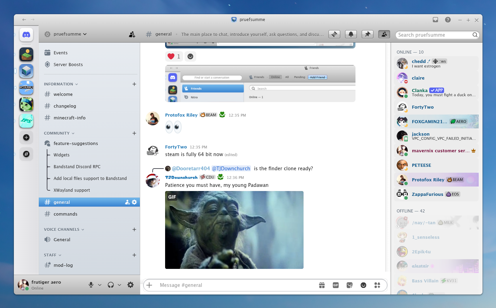

# Sea-Lion-Discord

Discord theme for the Sea Lion theme of the [Mavernix](https://github.com/Mavernix/mavernix) desktop. Makes Discord look like an OS X Mavericks app.



## Install

You need [BetterDiscord](https://betterdiscord.app).

Put `Mavericks.theme.css` in your themes folder and enable it in Settings > Themes.

```sh
cp Mavericks.theme.css ~/.config/BetterDiscord/themes/
```

Looks best with Lucida Grande installed. It falls back to Helvetica/Arial otherwise.

## Settings

Paste this into Custom CSS if you want to change something:

```css
:root {
    --mav-chat-font-size: 0.875rem;  /* message text size */
    --mav-chat-background: #ffffff;  /* #e0e4eb for the Messages.app look */
    --mav-sidebar-scrollbar: 0px;    /* 11px if you want a scrollbar in the channel list */
}
```

Discord renames its classes every now and then, so things might break. Open an issue if they do.
